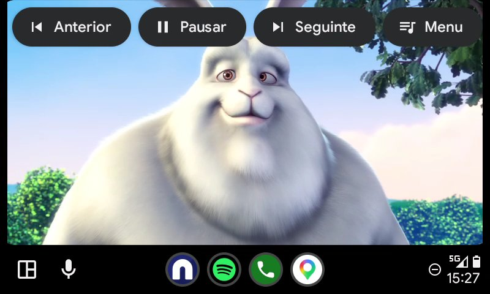
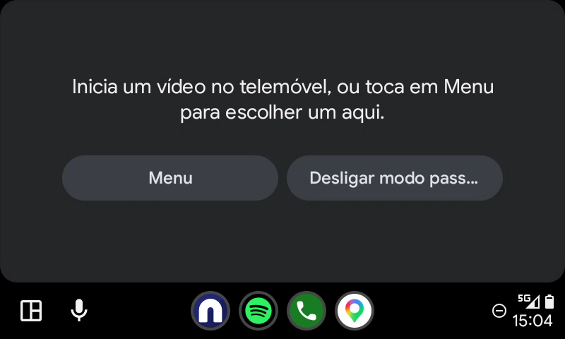
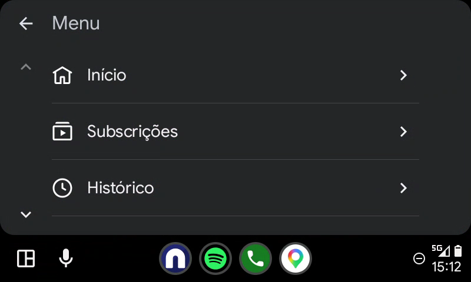

<div align="center">


# NewTube for Android Auto

### Passenger video on the car screen

An experimental fork of [NewTube](https://github.com/aleixrodriala/newtube) that adds an
Android Auto (projected) screen. The phone keeps the player; the car receives the live video
surface and a small set of controls.

[](#requirements)
[](#install)
[](LICENSE)
[](#status-and-limitations)



### [⬇ Download](https://github.com/ruipereira1/newtube-android-auto/releases/latest) · [How to install (simple guide)](docs/INSTALL.md) · [Como instalar (guia simples)](docs/INSTALL.pt.md)

</div>

> [!WARNING]
> **Passenger use only.** The driver must not watch video while driving. This is an
> experimental, sideloaded app. It is not affiliated with Google, Android Auto, YouTube,
> NewTube or SmartTube. Use it at your own risk and follow the law where you drive.

> **Português:** este fork mostra o vídeo do NewTube no ecrã do Android Auto para o passageiro.
> O condutor não deve ver vídeo. Guia de instalação simples:
> [docs/INSTALL.pt.md](docs/INSTALL.pt.md). Detalhes técnicos:
> [docs/ANDROID_AUTO.pt.md](docs/ANDROID_AUTO.pt.md).

## On the car screen

| Start | Menu | Watching |
|:--:|:--:|:--:|
|  |  |  |
| Start a video on the phone, or tap **Menu** | Home, Subscriptions, History, Playlists, Trending | Full screen, with Previous, Pause, Next and Menu |

*Screenshots from the Android Auto desktop head unit, with the app in Portuguese (it follows the
phone's language). Video: "Big Buck Bunny" © Blender Foundation, CC BY 3.0.*

## What this fork adds

- **Android Auto screen** with the live NewTube player, not a second player. The car gets the
  surface of the player that is already running on the phone.
- **Passenger mode on by default.** It can be turned off from the phone's Settings or from the
  car screen. When it is off, the car shows a message instead of video.
- **Car controls:** previous, play/pause, next and **Menu**.
- **Menu on the car screen:** Home, Subscriptions, History, Playlists and Trending, with
  thumbnails. Tap a video to play it; tap a playlist or channel to see its videos. Passenger
  mode is switched on and off at the bottom of the menu.
- **Full-screen video:** the video fills the whole car screen without being stretched.
- **Clean surface handoff:** the phone gets its own video surface back when the car screen stops
  or when the car app goes to the background.
- **Strings** in English, Spanish, Portuguese (Brazil) and Portuguese (Portugal).
- **Robolectric test** for the passenger-mode preference.
- **Explicit Car App Library permissions:** `androidx.car.app.ACCESS_SURFACE` and
  `androidx.car.app.NAVIGATION_TEMPLATES`.

## Requirements

- Android phone with **Android 7.0+** (API 24).
- The **Android Auto** app installed on the phone.
- A car or head unit with **Android Auto projected mode**. Tested on a Toyota Yaris 2025.
- A USB cable (or wireless Android Auto if the car and phone support it).
- Sideloaded APK. This fork is not distributed on Google Play.
- To build: **JDK 17+** (tested with JDK 21), **Android SDK 37**, and the git submodules.

## Install

**Step-by-step guide for everyone:** [English](docs/INSTALL.md) · [Português](docs/INSTALL.pt.md)

In short:

1. On the phone, download **NewTube-Android-Auto-arm64-v8a.apk** from the
   [latest release](https://github.com/ruipereira1/newtube-android-auto/releases/latest) and
   install it.
2. In **Android Auto** settings, tap **Version** ten times, then
   **⋮ → Developer settings → Unknown sources** on.
3. In the car, open **NewTube**, tap **Menu** and pick a video.

If NewTube does not appear in the car, install it with the computer installer from the same
release (`NewTube-Android-Auto-computer-installer.zip`, double-click `Install.bat`). It installs
the app the way Android Auto expects (as if it came from Google Play). The scripts are in
[`scripts/android-auto/`](scripts/android-auto/).

Passenger mode is switched on and off at the bottom of the car **Menu**, or on the phone in
**Settings → Android Auto passenger mode**.

## Build

```bash
git clone --recurse-submodules https://github.com/ruipereira1/newtube-android-auto.git
cd newtube-android-auto
echo "sdk.dir=/path/to/Android/Sdk" > local.properties
./gradlew :smarttubetv:assembleStmobileDebug
```

If the submodules are not present:

```bash
git submodule update --init --recursive
```

The debug APK is written to:

```text
smarttubetv/build/outputs/apk/stmobile/debug/
smarttubetv/build/outputs/renamed_apks/stmobileDebug/
```

The app runs on API 24 and later. The build is verified with JDK 21 and Android SDK 37; JDK 17
is the minimum supported by the project.

## Tests

```bash
./gradlew :smarttubetv:testStmobileDebugUnitTest \
  --tests 'com.newtube.mobile.car.CarModePrefsTest'
```

## How it works

The car app and the phone app run in the same process. The phone's
`MobilePlaybackActivity` owns the only `ExoPlayer`; the car app does not create a second one.

```text
Android Auto host
      │  SurfaceCallback (surface)
      ▼
CarVideoScreen ──────► CarDisplayBridge ◄────── MobilePlaybackActivity
  NavigationTemplate        weak ref + surface        ExoPlayer
  ActionStrip                attach / detach          phone surface
```

- `NewTubeCarAppService` is the `CarAppService`. It is declared with the `NAVIGATION`
  category because that is the only Car App Library category that receives a drawing surface.
- `NewTubeCarSession` creates `CarVideoScreen`.
- `CarVideoScreen` implements `SurfaceCallback`. It hands the host surface to
  `CarDisplayBridge` and builds a `NavigationTemplate` with an `ActionStrip`. When there is no
  player or passenger mode is off, it returns a `MessageTemplate`.
- `CarDisplayBridge` holds a weak reference to the activity and the current car surface. When
  the activity is created after the car screen, it attaches the surface immediately. When the
  car screen stops, the phone gets its own surface back.
- `CarModePrefs` stores the passenger-mode switch. It is on by default.
- `MobilePlaybackActivity` uses the car surface instead of the phone surface while the car
  screen is active, and restores the phone surface when it is not.

The manifest declares:

- `androidx.car.app.ACCESS_SURFACE` — required to receive a surface from the host.
- `androidx.car.app.NAVIGATION_TEMPLATES` — required by `NavigationTemplate`. Without it the
  host rejects the screen when the app is opened.
- `com.newtube.mobile.car.NewTubeCarAppService` with the
  `androidx.car.app.CarAppService` action and the `androidx.car.app.category.NAVIGATION`
  category.
- `androidx.car.app.minCarApiLevel=1` as **application** metadata (directly inside
  `<application>`, not inside `<service>`). Android Auto only looks for it there; if it is
  missing, the car screen shows "unexpected error" as soon as the app is opened.
- `com.google.android.gms.car.application` metadata pointing to
  `res/xml/automotive_app_desc.xml`, which declares `<uses name="template" />`.

## Code map

```text
smarttubetv/src/stmobile/java/com/newtube/mobile/car/
  NewTubeCarAppService.java   CarAppService entry point
  NewTubeCarSession.java      one Android Auto session
  CarVideoScreen.java         NavigationTemplate + SurfaceCallback (the player screen)
  CarLetterbox.java           fills the car screen with the video without stretching it
  CarMenuScreen.java          the Menu: Home, Subscriptions, History, Playlists, Trending
  CarVideoListScreen.java     a list of videos; tap to play, or open a playlist/channel
  CarModePrefs.java           passenger-mode preference (default on)

smarttubetv/src/stmobile/java/com/newtube/mobile/ui/playback/
  CarDisplayBridge.java       weak activity reference + car surface handoff
  MobilePlaybackActivity.java player owner; switches between phone and car surface

smarttubetv/src/stmobile/AndroidManifest.xml
  Car permissions, CarAppService and automotive metadata

smarttubetv/src/stmobile/res/xml/automotive_app_desc.xml
  <uses name="template" />

smarttubetv/src/stmobile/res/values*/strings_mobile.xml
  car_* strings (EN, ES, PT-BR, PT-PT)

smarttubetv/src/testStmobile/java/com/newtube/mobile/car/CarModePrefsTest.java
  Robolectric test for the passenger-mode preference
```

## Troubleshooting

### NewTube does not appear in the Android Auto launcher

- Enable **Developer mode** in Android Auto and then **Unknown sources** in Developer settings.
- Make sure the APK is installed for the same user profile that is connected to the car.
- Restart the Android Auto app and reconnect the USB cable.
- Use a data-capable USB cable, not a charge-only cable.
- Confirm the car supports Android Auto projected mode.

### The app opens with an error

- If the log says `Min API level not declared in manifest`, the APK was built before this was
  fixed. Install a build from the current code.
- Confirm the installed APK contains both `androidx.car.app.ACCESS_SURFACE` and
  `androidx.car.app.NAVIGATION_TEMPLATES`.
- Update Android Auto on the phone.
- Capture the crash:

```bash
adb logcat -c
# open the app in Android Auto and reproduce the error
adb logcat -d | grep -a -iE "AndroidRuntime|app.smarttube|newtube|carapp|FATAL|Exception"
```

### The phone plays video but the car screen stays empty

- Start the video on the phone first; the car screen follows the live player.
- Check that passenger mode is on.
- Some cars and Android Auto versions do not expose a surface to third-party template apps.
- Tap the car screen once; some hosts only deliver surface gestures after a tap.

### The car controls do nothing

- The action strip only exists while a player is active.
- Some hosts do not forward taps or flings on the surface; use the action strip.
- If the host hides the action strip while driving, use the phone for that action.

### The APK will not install

If Android reports a signature mismatch, uninstall the previous NewTube build first. Debug
builds are signed with a local debug key, which can change between machines.

## Status and limitations

- Experimental. Tested with a Toyota Yaris 2025 in Android Auto projected mode.
- This is not a navigation app. `NavigationTemplate` is used only because it is the template
  that receives a surface; Google or a car maker may restrict this use.
- Video while the car is moving is for passengers only. The driver must not watch it.
- The phone must stay connected and keep the player alive. The car screen is a second display,
  not an independent player.
- Some Android Auto hosts and some cars do not support third-party template apps with a
  surface. In that case the app can appear in the launcher but show a message or no video.
- The video fills the car screen and keeps its shape. When the screen is wider than the
  video, a thin strip at the top and bottom of the picture is cut off; it is never stretched.
- The car menu shows as many rows as Android Auto allows. While driving, Android Auto may show
  fewer rows or lock some lists.
- No Play Store distribution. Sideload only.

## Credits

This fork builds on the work of:

- [NewTube](https://github.com/aleixrodriala/newtube) by
  [@aleixrodriala](https://github.com/aleixrodriala) — the phone UI, player and offline support.
- [SmartTube](https://github.com/yuliskov/SmartTube) by
  [@yuliskov](https://github.com/yuliskov) and contributors — the engine, accounts and
  integrations.
- [androidx Media3](https://developer.android.com/media/media3) — playback.
- [SponsorBlock](https://sponsor.ajay.app), [DeArrow](https://dearrow.ajay.app) and
  [Return YouTube Dislike](https://returnyoutubedislike.com) — the optional integrations.

The upstream NewTube README is preserved at [README.upstream.md](README.upstream.md). SmartTube's
original README is at [docs/UPSTREAM_README_SmartTube.md](docs/UPSTREAM_README_SmartTube.md).
Full notices are in [THIRD_PARTY_NOTICES.md](THIRD_PARTY_NOTICES.md).

## License

[MIT](LICENSE), the same as NewTube and SmartTube. © yuliskov (SmartTube) and NewTube
contributors. Android Auto changes in this fork are by
[@ruipereira1](https://github.com/ruipereira1).
