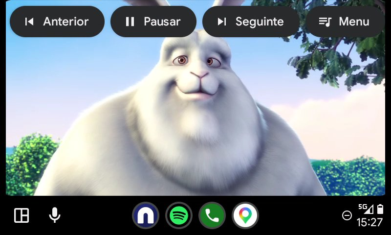
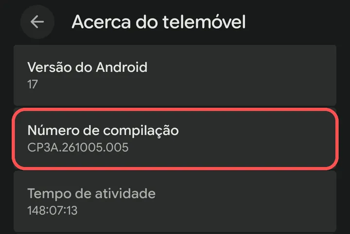
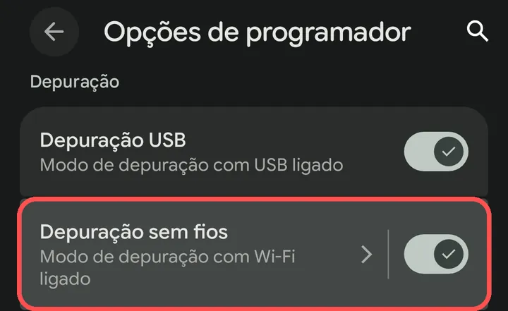
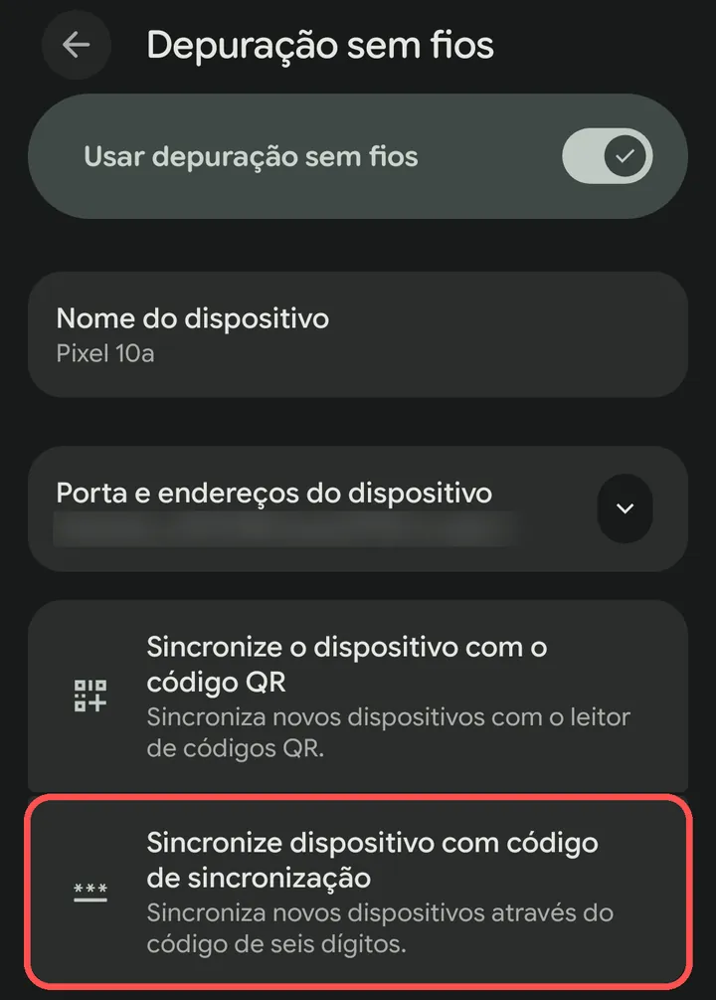
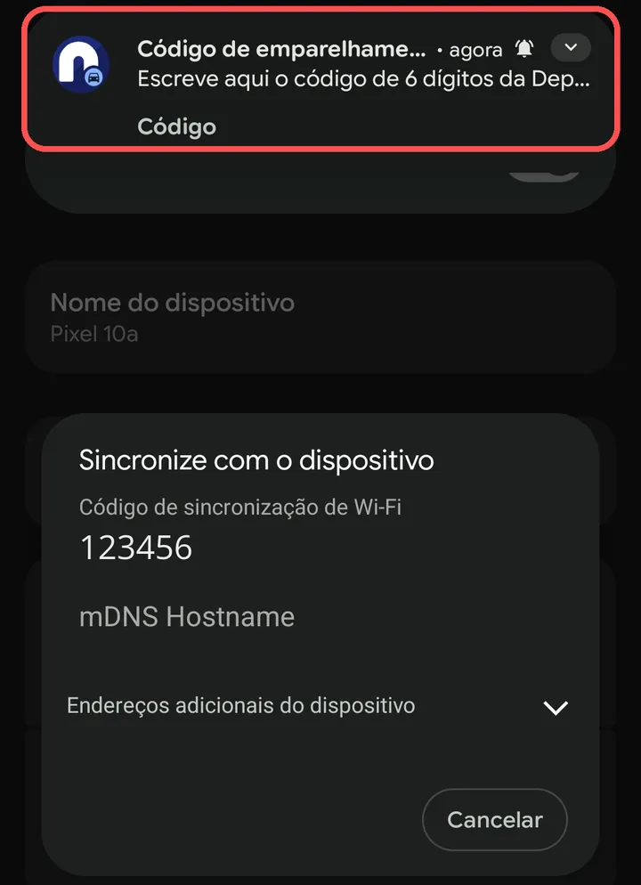
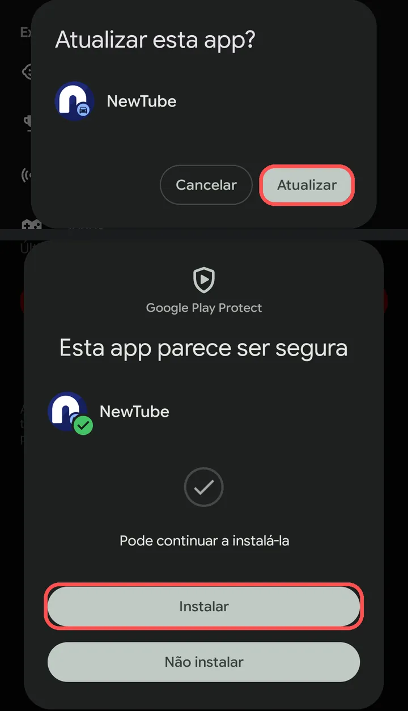
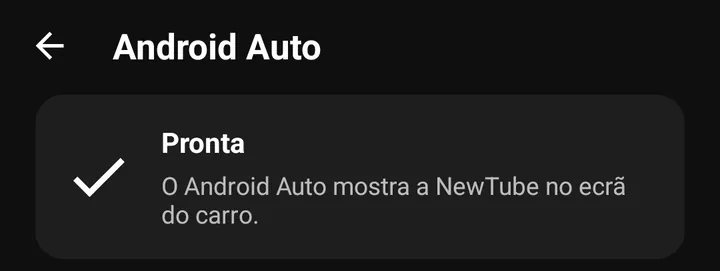
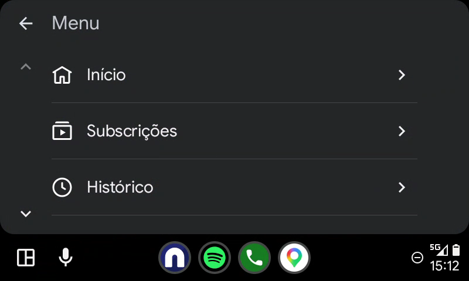

# Install NewTube on your car screen

**Português:** [INSTALL.pt.md](INSTALL.pt.md)

This guide is for everyone, no technical knowledge needed. It takes about 10 minutes.

  

> [!WARNING]
> **For passengers only.** The driver must never watch video while driving.

## What you need

- An **Android phone** (Android 7 or newer; setting it up without a computer needs Android 11).
- A **car with Android Auto** (with a cable or wireless).
- The **Android Auto** app on the phone (most phones already have it).

## Step 1 — Download the app on your phone

1. On your phone, open this page: **[latest version](https://github.com/ruipereira1/newtube-android-auto/releases/latest)**.
2. Scroll down to **Assets** and tap **NewTube-Android-Auto-arm64-v8a.apk**.

   *Very old phone? Pick `armeabi-v7a`. Not sure? Pick `universal` (it is bigger but works on every phone).*

## Step 2 — Install it

1. When the download finishes, tap the file to open it.
2. If the phone says it is not allowed to install apps from this source, tap **Settings**,
   turn on **Allow from this source**, then go back.
3. Tap **Install**.
4. If **Google Play Protect** shows a warning, tap **More details → Install anyway**.

## Step 3 — Turn it on for Android Auto (once)

Android Auto only lists apps that look like they came from Google Play. NewTube can reinstall
itself that way from the phone itself, with no cable or computer. It needs **Android 11 or
newer** and **Wi-Fi**, takes about a minute and is done once.

Open NewTube and go to **You → Android Auto**. The app shows these steps (Portuguese screens
below) and moves on by itself:

1. **Turn on Developer options:** in **About phone**, tap **Build number** 7 times.

   

2. **Turn on Wireless debugging** in Developer options. If asked, allow it on this network.

   

3. In NewTube tap **Start**. In Wireless debugging, tap **Pair device with pairing code** and
   leave the code on screen.

   

4. A NewTube notification appears: tap **Code** and type the 6 digits. (If it is gone, pull down
   the notifications.)

   

5. Tap **Update**. If Google Play Protect asks, tap **Scan app** and then **Install**.

   

Done: **You → Android Auto** says **Ready**.

## Step 4 — Use it in the car

1. Connect the phone to the car.
2. On the car screen, open the app list and tap **NewTube**.
3. Tap **Menu** and pick a video, or start a video on the phone. It appears on the car screen.

  
  

| Button | What it does |
|:--|:--|
| **Previous / Next** | Previous or next video (or jumps 10 seconds if there is none) |
| **Pause / Play** | Pauses or plays the video |
| **Menu** | Home, Subscriptions, History, Playlists and the passenger-mode switch |

**On the video itself:**

- **Tap once** to show the buttons. They hide again after about 10 seconds.
- **Double tap on the right side** to skip forward 10 seconds, **on the left side** to go back
  10 seconds. Keep double tapping to skip more (+20, +30 seconds...).

*The pictures show the app in Portuguese; it follows your phone's language.*

## NewTube does not appear in the car?

- Check that **You → Android Auto** says **Ready**. If not, do Step 3.
- Android 10 or older, or no Wi-Fi? Use a computer:
  1. On the phone, turn on **USB debugging**: **Settings → About phone →** tap **Build number**
     7 times, then **Developer options → USB debugging**.
  2. On the computer, open **[newtube-auto-instalar.netlify.app](https://newtube-auto-instalar.netlify.app)**
     in Chrome or Edge, connect the phone with a cable and follow the steps. Or use
     **NewTube-Android-Auto-computer-installer.zip** from the
     [latest release](https://github.com/ruipereira1/newtube-android-auto/releases/latest).
  3. On the phone, tap **Allow** (USB debugging) and then **Install** / **Update**.

## Updating

In **You → Android Auto**, when there is a new version, tap **Update** (on Wi-Fi). No code and no
need to turn on Wireless debugging: the app turns it on, installs and turns it off again. Then
tap **Update** on the install screen. Your settings stay.

Had an early test version of NewTube for Android Auto? It is a separate app: after installing
this one, uninstall the old one so you don't have two NewTube icons.

## Other problems

| Problem | What to do |
|:--|:--|
| The car screen says to start a video | Tap **Menu** and pick one, or start a video on the phone. |
| The car shows a message instead of video | Passenger mode is off: open **Menu** and turn on **Passenger mode**. |
| A list says it could not load | Check that the phone has internet, then open the list again. |
| The video stops when the car moves | Android Auto limits what apps can do while driving; this depends on the car. |

Still stuck? [Open an issue](https://github.com/ruipereira1/newtube-android-auto/issues) and
say which phone and car you have.
