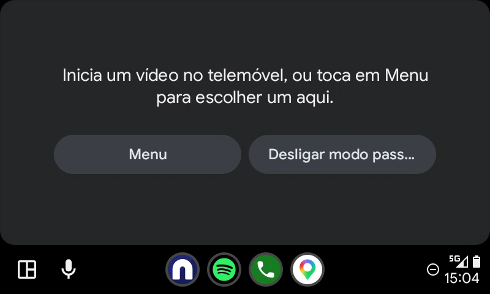

# Install NewTube on your car screen

**Português:** [INSTALL.pt.md](INSTALL.pt.md)

This guide is for everyone, no technical knowledge needed. It takes about 10 minutes.

  

> [!WARNING]
> **For passengers only.** The driver must never watch video while driving.

## What you need

- An **Android phone** (Android 7 or newer).
- A **car with Android Auto** (with a cable or wireless).
- The **Android Auto** app on the phone (most phones already have it).

## Step 1 — Download the app on your phone

1. On your phone, open this page: **[latest version](https://github.com/ruipereira1/newtube-android-auto/releases/latest)**.
2. Scroll down to **Assets** and tap **NewTube-Android-Auto-arm64-v8a.apk**.

   *Very old phone? Pick `armeabi-v7a`. Not sure? Pick `universal` (it is bigger but works on every phone).*

## Step 2 — Install it

1. When the download finishes, tap the file to open it.
2. If the phone says it is not allowed to install apps from this source, tap **Settings**,
   turn on **Allow from this source**, then go back.
3. Tap **Install**.
4. If **Google Play Protect** shows a warning, tap **More details → Install anyway**.

## Step 3 — Let Android Auto show the app

Android Auto hides apps that do not come from Google Play unless you allow them. You only do
this once.

1. Open the phone's **Settings** and search for **Android Auto**. Open it.
2. Scroll to the bottom and tap **Version** **10 times**, until a message asks to turn on
   developer settings. Tap **OK**.
3. Tap the **⋮** menu at the top right, then **Developer settings**.
4. Turn on **Unknown sources**.

## Step 4 — Use it in the car

1. Connect the phone to the car.
2. On the car screen, open the app list and tap **NewTube**.
3. Tap **Menu** and pick a video, or start a video on the phone. It appears on the car screen.

  
  

| Button | What it does |
|:--|:--|
| **Previous / Next** | Previous or next video (or jumps 10 seconds if there is none) |
| **Pause / Play** | Pauses or plays the video |
| **Menu** | Home, Subscriptions, History, Playlists, Trending and the passenger-mode switch |

*The pictures show the app in Portuguese; it follows your phone's language.*

## NewTube does not appear in the car?

On many phones, Android Auto only shows apps that look as if they came from Google Play, even
after Step 3. A computer fixes this in a couple of minutes:

1. On the phone, turn on **USB debugging**:
   **Settings → About phone →** tap **Build number** 7 times, then
   **Settings → System → Developer options → USB debugging**.
2. On the computer, open the
   **[latest version](https://github.com/ruipereira1/newtube-android-auto/releases/latest)**
   and download **NewTube-Android-Auto-computer-installer.zip**. Unzip it.
3. Connect the phone to the computer with a USB cable.
4. **Windows:** double-click **Install.bat**.
   **Mac or Linux:** open a terminal in the folder and run `./install.sh`.
5. On the phone, tap **Allow** (USB debugging) and then **Install** / **Update**.

When the window says **Done**, reconnect the phone to the car. Use the same installer for every
update.

## Updating

Download the new version from the
[latest release](https://github.com/ruipereira1/newtube-android-auto/releases/latest) and install
it the same way. It installs over the old one and keeps your settings. (The app does not update
itself.)

Had an early test version of NewTube for Android Auto? It is a separate app: after installing
this one, uninstall the old one so you don't have two NewTube icons.

## Other problems

| Problem | What to do |
|:--|:--|
| The car screen says to start a video | Tap **Menu** and pick one, or start a video on the phone. |
| The car shows a message instead of video | Passenger mode is off: open **Menu** and turn on **Passenger mode**. |
| A list says it could not load | Check that the phone has internet, then open the list again. |
| The video stops when the car moves | Android Auto limits what apps can do while driving; this depends on the car. |

Still stuck? [Open an issue](https://github.com/ruipereira1/newtube-android-auto/issues) and
say which phone and car you have.
