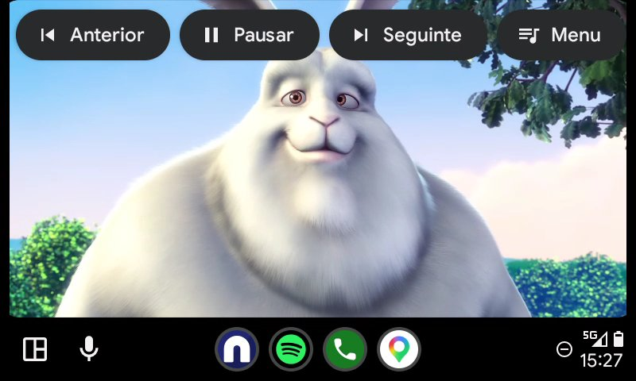
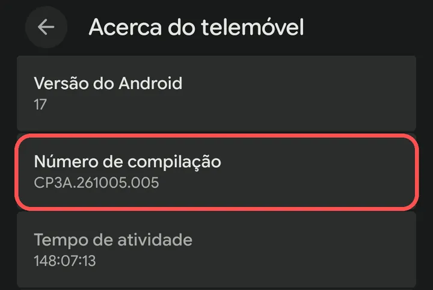
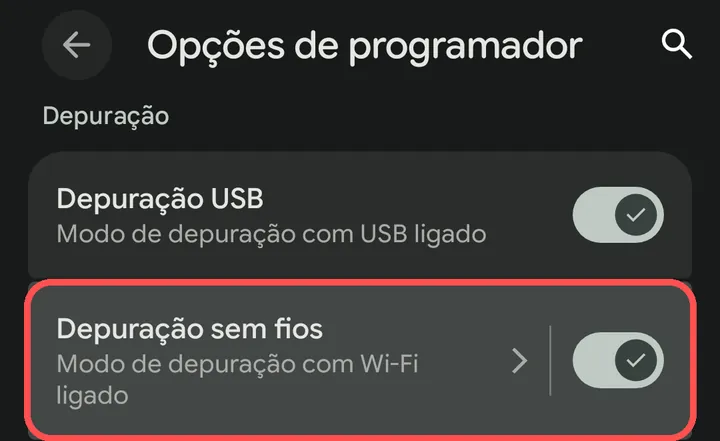
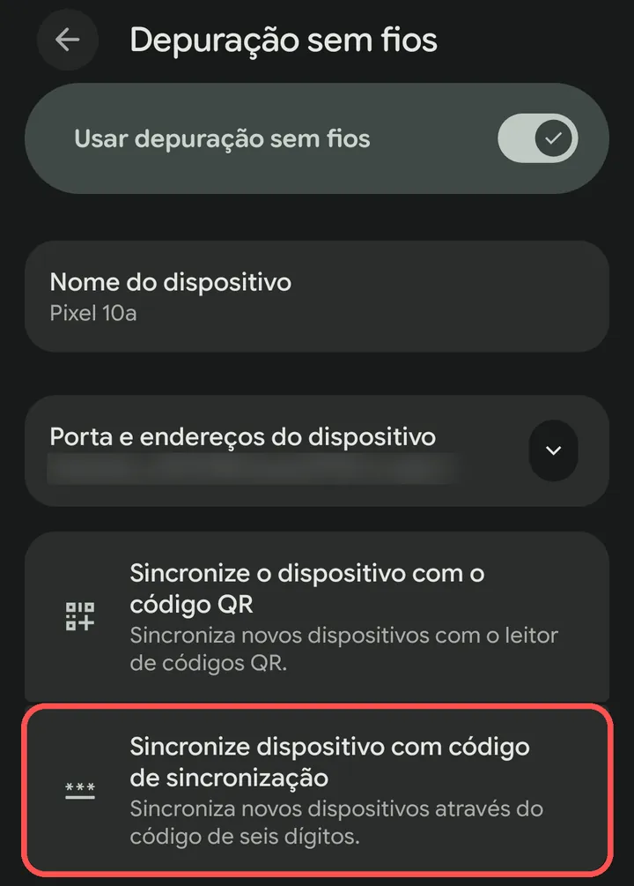
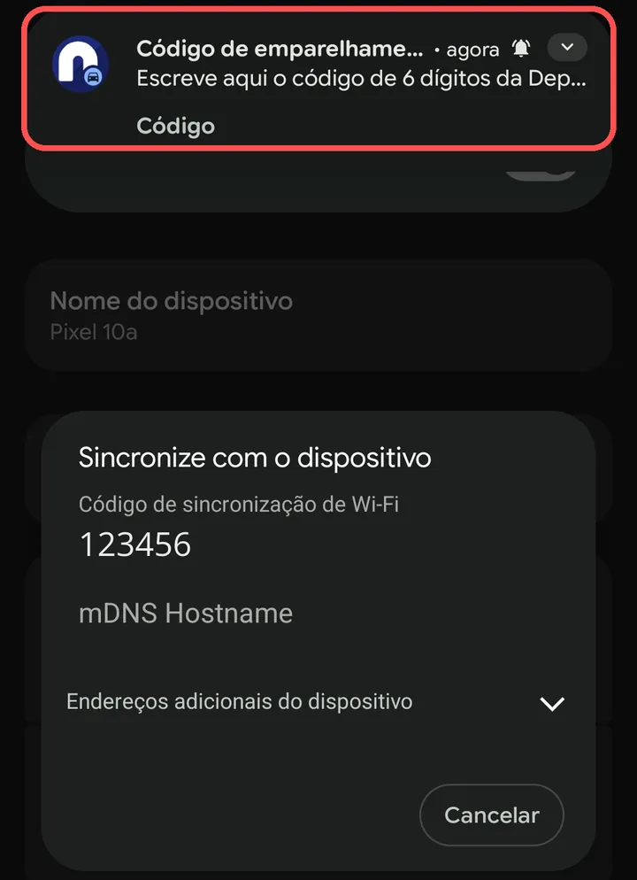
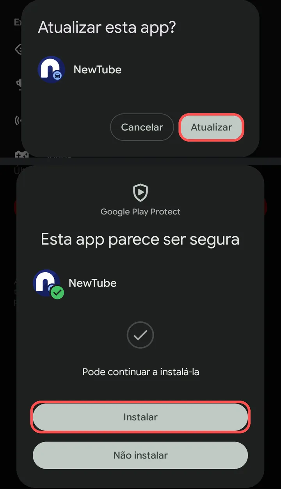
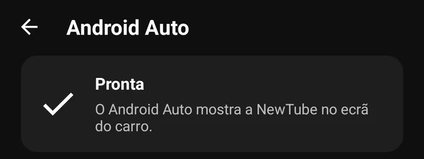
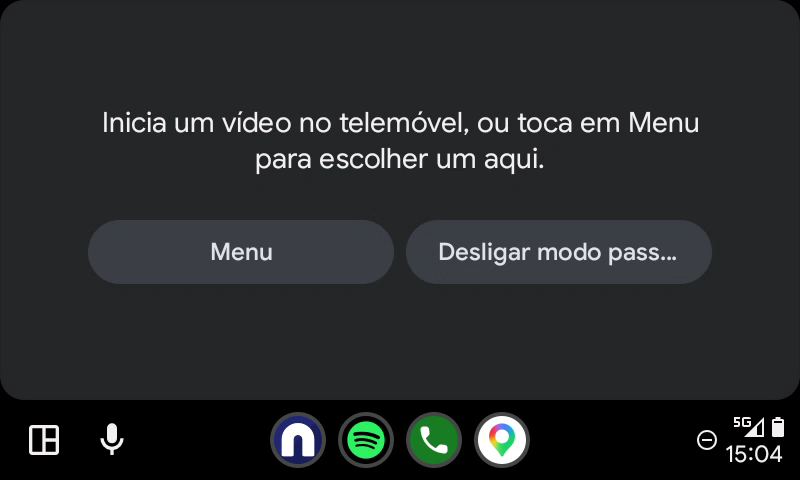
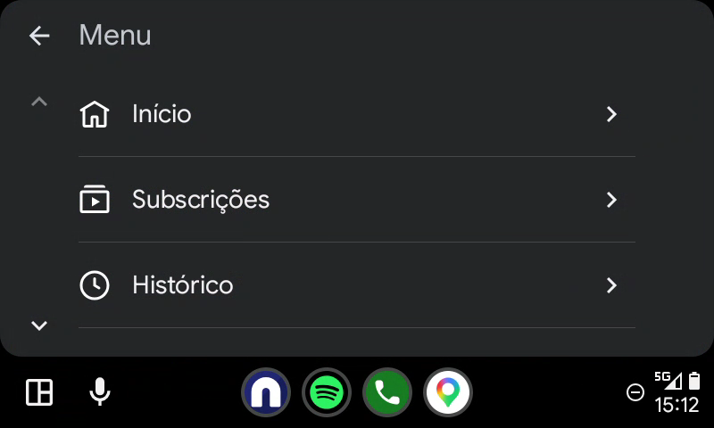

# Instalar o NewTube no ecrã do carro

**English:** [INSTALL.md](INSTALL.md)

Este guia é para toda a gente, não é preciso saber nada de técnico. Demora uns 10 minutos.

  

> [!WARNING]
> **Só para passageiros.** O condutor nunca deve ver vídeo enquanto conduz.

## O que precisas

- Um **telemóvel Android** (Android 7 ou mais recente; a ativação sem computador precisa de Android 11).
- Um **carro com Android Auto** (com cabo ou sem fios).
- A app **Android Auto** no telemóvel (a maioria dos telemóveis já a tem).

## Passo 1 — Descarregar a app no telemóvel

1. No telemóvel, abre esta página: **[versão mais recente](https://github.com/ruipereira1/newtube-android-auto/releases/latest)**.
2. Desce até **Assets** e toca em **NewTube-Android-Auto-arm64-v8a.apk**.

   *Telemóvel muito antigo? Escolhe `armeabi-v7a`. Não sabes? Escolhe `universal` (é maior, mas funciona em todos).*

## Passo 2 — Instalar

1. Quando o download acabar, toca no ficheiro para o abrir.
2. Se o telemóvel disser que não pode instalar apps desta origem, toca em **Definições**,
   ativa **Permitir desta origem** e volta atrás.
3. Toca em **Instalar**.
4. Se o **Google Play Protect** mostrar um aviso, toca em **Mais detalhes → Instalar mesmo assim**.

## Passo 3 — Ativar no Android Auto (uma vez só)

O Android Auto só mostra apps que pareçam vir da Google Play. A NewTube consegue reinstalar-se
assim a partir do próprio telemóvel, sem cabo nem computador. Precisa de **Android 11 ou mais
recente** e de **Wi-Fi**. Demora cerca de um minuto e só se faz uma vez.

Abre a NewTube e vai a **Tu → Android Auto**. A app mostra estes passos e avança sozinha:

1. **Ativa as Opções de programador:** em **Acerca do telemóvel**, toca 7 vezes em **Número de
   compilação** (pode pedir o PIN).

   

2. **Liga a Depuração sem fios** nas Opções de programador. Se perguntar, permite nesta rede.

   

3. Na NewTube toca em **Começar**. Na Depuração sem fios, toca em **Sincronize dispositivo com
   código de sincronização** e deixa o código no ecrã.

   

4. Aparece uma notificação da NewTube: toca em **Código** e escreve os 6 dígitos. (Se a
   notificação já tiver desaparecido, puxa a barra de notificações.)

   

5. Toca em **Atualizar**. Se o Google Play Protect pedir, toca em **Analisar app** e depois em
   **Instalar**.

   

Pronto: em **Tu → Android Auto** aparece **Pronta**.

*Os menus mudam de marca para marca: num Samsung o Número de compilação está em Informações do
software; num Xiaomi toca na versão do MIUI/HyperOS.*

## Passo 4 — Usar no carro

1. Liga o telemóvel ao carro.
2. No ecrã do carro, abre a lista de apps e toca em **NewTube**.
3. Toca em **Menu** e escolhe um vídeo, ou inicia um vídeo no telemóvel. Ele aparece no ecrã
   do carro.

  
  

| Botão | O que faz |
|:--|:--|
| **Anterior / Seguinte** | Vídeo anterior ou seguinte (ou salta 10 segundos, se não houver) |
| **Pausar / Reproduzir** | Pausa ou continua o vídeo |
| **Menu** | Início, Subscrições, Histórico, Playlists e o interruptor do modo passageiro |

**No próprio vídeo:**

- **Um toque** mostra os botões. Escondem-se outra vez ao fim de uns 10 segundos.
- **Toque duplo do lado direito** avança 10 segundos; **do lado esquerdo** recua 10 segundos.
  Continua a tocar duas vezes para saltar mais (+20, +30 segundos...).

## O NewTube não aparece no carro?

- Confirma que em **Tu → Android Auto** aparece **Pronta**. Se não, faz o Passo 3.
- Telemóvel com Android 10 ou mais antigo, ou sem Wi-Fi? Usa o computador:
  1. No telemóvel, ativa a **depuração USB**: **Definições → Acerca do telemóvel →** toca 7
     vezes em **Número de compilação**, e depois **Opções de programador → Depuração USB**.
  2. No computador, abre **[newtube-auto-instalar.netlify.app](https://newtube-auto-instalar.netlify.app)**
     no Chrome ou no Edge, liga o telemóvel por cabo e segue os passos. Também podes usar o
     **NewTube-Android-Auto-computer-installer.zip** da
     [versão mais recente](https://github.com/ruipereira1/newtube-android-auto/releases/latest).
  3. No telemóvel, toca em **Permitir** (depuração USB) e depois em **Instalar** / **Atualizar**.

## Atualizar

Em **Tu → Android Auto**, quando houver versão nova, toca em **Atualizar** (por Wi-Fi). Não
precisas de código nem de ligar a Depuração sem fios: a app liga-a, instala e desliga-a no fim.
Depois toca em **Atualizar** no ecrã de instalação. As tuas definições ficam.

Tinhas uma versão de teste antiga do NewTube para Android Auto? É uma app separada: depois de
instalares esta, desinstala a antiga para não ficares com dois ícones do NewTube.

## Outros problemas

| Problema | O que fazer |
|:--|:--|
| O ecrã do carro pede para iniciar um vídeo | Toca em **Menu** e escolhe um, ou inicia um vídeo no telemóvel. |
| O carro mostra uma mensagem em vez do vídeo | O modo passageiro está desligado: abre o **Menu** e ativa **Modo passageiro**. |
| Uma lista diz que não foi possível carregar | Confirma que o telemóvel tem internet e abre a lista outra vez. |
| O vídeo para quando o carro anda | O Android Auto limita o que as apps fazem em andamento; depende do carro. |

Continuas com problemas? [Abre um pedido (issue)](https://github.com/ruipereira1/newtube-android-auto/issues)
e diz qual é o teu telemóvel e o teu carro.
